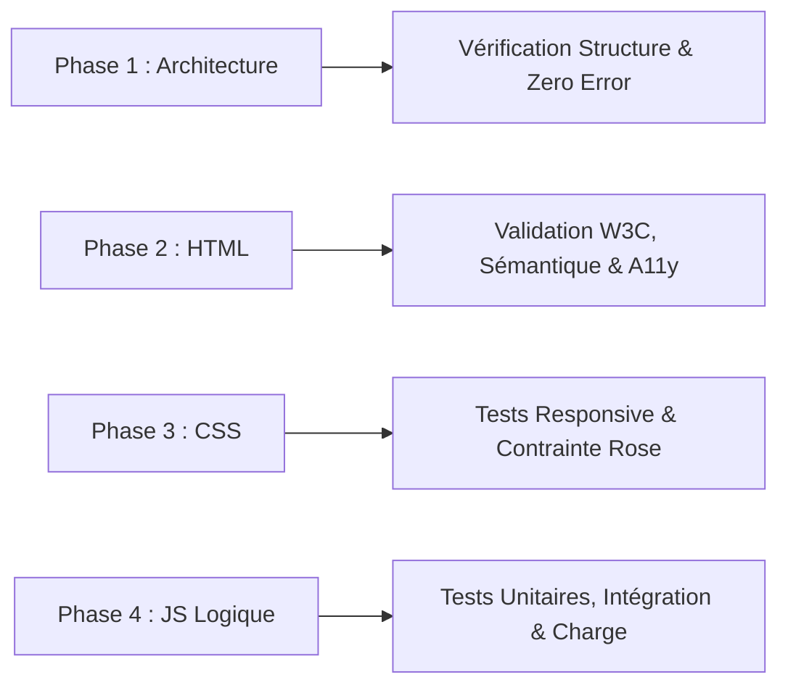

# 6. Plan de Tests & Protocole d'Assurance Qualité (QA)

Ce document établit la stratégie de test complète à appliquer à chaque étape (phase) du développement de **Table Clicker Puzzle**. Il garantit la stabilité, la non-régression et le respect strict de la contrainte **"Zéro Erreur Console"**.

---

## 1. Typologie des Tests du Projet

| Type de Test | Périmètre & Objectif | Méthode d'Exécution |
| :--- | :--- | :--- |
| **🧪 Tests Unitaires** | Valider les fonctions logiques isolées (calcul du coût d'une upgrade, prime de complétion, incrément de ressources, formatage $1\text{k}/1\text{M}$). | Exécution de scénarios de calculs en console ou via une suite de tests lightweight. |
| **🧩 Tests de Composants** | Vérifier le rendu et le comportement des briques visuelles isolées (grille de puzzle $N\times N$, carte d'upgrade, jauge de cooldown, bouton audio). | Inspection du DOM, états des classes CSS et attributs HTML (`disabled`, `aria-label`). |
| **🔗 Tests d'Intégration** | Contrôler la communication entre les modules : Clic $\to$ état mis à jour $\to$ re-rendu de l'UI ; Achat d'une upgrade $\to$ déduction monétaire $\to$ mise à jour du timer passif. | Simulation d'actions chaînées et vérification de la cohérence globale de `gameState`. |
| **🚀 Tests End-to-End (E2E)** | Valider le parcours complet d'un joueur : de la première pièce posée au déblocage d'un puzzle supérieur et d'une série d'upgrades. | Parcours automatisé ou guidé dans le navigateur simulant une session réelle. |
| **⚡ Tests de Charge & Robustesse** | Vérifier la résistance au spam de clics (autoclicker à 50 clics/s), le comportement lors de la mise en arrière-plan de l'onglet (delta-time), et l'affichage des très grands nombres. | Simulation de rafales d'événements et stress-test de la boucle de jeu. |

---

## 2. Grille de Validation Phase par Phase

À chaque livraison d'une phase, la série de tests associée doit être validée avec succès.

---

### Phase 1 : Architecture & Fondations
- **Test Unitaire / Structure** :
  - Vérifier la présence et les chemins d'accès des 3 fichiers (`index.html`, `style.css`, `script.js`).
  - Vérifier que `gameState` est accessible et initialise correctement toutes les propriétés requises.
- **Test Console** :
  - Ouvrir la console du navigateur : confirmer qu'aucun message d'erreur ni d'avertissement n'apparaît au chargement.

---

### Phase 2 : Structuration HTML
- **Test Sémantique & Validation W3C** :
  - Aucun élément déprécié.
  - Présence des balises sémantiques (`<header>`, `<main>`, `<section>`, `<aside>`).
- **Test Composants & Accessibilité (A11y)** :
  - Tous les boutons possèdent `type="button"`.
  - Tous les boutons sans texte explicite possèdent un attribut `aria-label`.
  - La hiérarchie des titres (`<h1>`, `<h2>`, `<h3>`) est strictement croissante sans sauts.
- **Test de Séparation** :
  - Aucun attribut `style=""` ni aucun attribut `onclick=""` dans le balisage HTML.

---

### Phase 3 : Stylisation & Design CSS
- **Test Visuel & Charte** :
  - Présence et utilisation effective de la couleur **Rose Flashy (`#F60887`)** sur les boutons actifs et éléments en surbrillance.
  - Lisibilité des textes (contraste suffisant sur fond sombre).
- **Test Responsive (Composants & Layout)** :
  - Test d'affichage sur écran large Desktop ($1920\times1080$), Laptop ($1366\times768$), et Tablette ($768\times1024$).
  - Aucun débordement horizontal indésirable (overflow).
- **Test de Confort** :
  - Vérifier que le double-clic ou le martèlement de clics ne sélectionne pas de texte bleu grâce à `user-select: none`.

---

### Phase 4 : Logique du Jeu, Upgrades & Robustesse

#### A. Tests Unitaires (Logique Pure)
1. **Calcul des Coûts d'Upgrade** :
   - Formule : $\text{Coût} = \text{Coût Initial} \times (\text{Multiplicateur})^{\text{Niveau}}$.
   - Vérifier que pour *Doigts agiles* (base 15, mult 1.6) : Niveau 0 $\to$ 15, Niveau 1 $\to$ 24, Niveau 2 $\to$ 38.
2. **Calcul des Primes de Complétion de Puzzle** :
   - Vérifier que la prime est proportionnelle à la taille de la grille (ex: $N \times 10$ pièces).
3. **Formatage des Nombres** :
   - Tester les valeurs frontières : `999` $\to$ `"999"`, `1000` $\to$ `"1.0k"`, `1500000` $\to$ `"1.5M"`.

#### B. Tests d'Intégration (Flux de Données)
1. **Cycle Clic $\to$ Grille $\to$ Complétion** :
   - Cliquer pour générer des pièces : la grille se colore case par case.
   - À 100% de remplissage : le compteur de puzzles résolus s'incrémente de $+1$, la prime est créditée, et la grille passe au format suivant ($4\times4$).
2. **Achat d'Upgrade $\to$ Ressources** :
   - Tenter un achat sans avoir les pièces nécessaires : l'achat est refusé, aucune ressource n'est déduite.
   - Acheter avec ressources suffisantes : solde débité, niveau incrémenté, mise à jour immédiate de la mécanique (production passive ou clic).
3. **Persistance `localStorage`** :
   - Jouer quelques secondes, recharger la page (`F5`) : vérifier que le solde, les puzzles résolus et les niveaux d'upgrades sont fidèlement restaurés.

#### C. Tests de Charge & Anti-Spam (Stress Test)
1. **Simulation Autoclicker** :
   - Simuler 100 clics consécutifs à intervalle de 10ms.
   - Vérifier que le cooldown bloque les clics non autorisés et qu'aucune désynchronisation de l'état ne survient.
2. **Test d'Inactivité & Onglet en Arrière-plan (Delta Time)** :
   - Activer une upgrade passive (ex: +2 pièces/s).
   - Masquer l'onglet pendant 30 secondes.
   - Revenir sur l'onglet : vérifier que les ~60 pièces passives ont bien été créditées via le calcul de `Date.now()`.

#### D. Test End-to-End (E2E)
- Scénario complet :
  1. Démarrage à 0 pièces, grille $3\times3$ vide.
  2. Clics manuels jusqu'à résolution du premier puzzle ($9$ pièces).
  3. Réception de la prime de puzzle.
  4. Achat de la première amélioration *Doigts agiles*.
  5. Vérification du gain accru par clic (+2 pièces au lieu de +1).
  6. Résolution du deuxième puzzle ($16$ pièces).
  7. Contrôle final : **0 erreur dans la console navigateur**.
