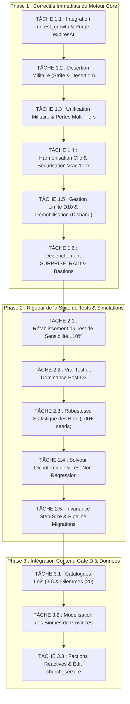

# Plan de Remédiation Technique & Assurance Qualité (`docs/plan/`)

> **Document de Pilotage des Correctifs & Consolidation du Core Engine**  
> Ce document fait suite à l'audit exhaustif du moteur (`src/core/`), des données (`src/data/`) et de la suite de tests (`src/__tests__/`), en prenant en compte le journal de conception et réalisation [`docs/making/README.md`](../making/README.md).  
> Il détaille de manière opérationnelle l'ensemble des étapes d'ingénierie nécessaires pour remédier aux anomalies identifiées avant le gel définitif du Core V1 et la transition vers l'interface V2.

---

## 1. Contexte & Diagnostic Croisé (`docs/making/` vs Code Réel)

Le document [`docs/making/README.md`](../making/README.md) synthétise les intentions d'architecture et les moteurs introduits lors de la fermeture des Gates A à E :
- Introduction de Mulberry32 (`prng.ts`), du combat asymétrique (`battle.ts`), du replay déterministe (`replay.ts`), des migrations sans `any` (`migrations.ts`), du bassin de serfs partagé et de la composition universelle des statistiques.

Cependant, l'audit d'ingénierie a mis en évidence **des décalages d'intégration critiques et des raccourcis de validation** entre ce qui a été consigné et le comportement effectif du runtime :
1. **Ruptures dans la boucle de simulation (`engine.ts`)** : La stat `'unrest_growth'` n'est jamais composée dans le tick, l'expiration temporelle `expiresAt` des modificateurs n'est pas purgée, et la désertion des troupes (75-89% d'Unrest) est absente.
2. **Incohérences de câblage dans les commandes (`commands.ts`)** : Calcul de puissance militaire tronqué ignorant les officiers en combat, pertes d'attrition limitées aux simples soldats (épargnant le Tier II), et absence de vérification du mode vrac 100x.
3. **Fragilités de la suite de simulation (`archetypeBots.spec.ts`)** : Échantillonnage réduit (20 à 25 parties au lieu de 200 à 1 000), contournement systématique de 100% des lois et expéditions par les bots, test de sensibilité cosmétique (comparaison de deux graines sans variation paramétrique), et test de dominance incomplet.
4. **Contenu Gate D en suspens** : Les 30 lois, les 20 dilemmes et les 6 factions réactives sont absents, laissant les commandes associées à l'état de *no-ops*.

---

## 2. Matrice des Tâches de Remédiation Priorisées



---

## 3. Spécification Détaillée des Étapes de Remédiation

### Phase 1 : Correctifs d'Intégrité du Moteur Core (`src/core/`)

#### Tâche 1.1 : Intégration de `unrest_growth` et Purge Temporelle des Modificateurs
- **Fichiers impactés** : `src/core/engine.ts`, `src/core/modifiers.ts`
- **Problème** : Dans `engine.ts` L331-340, `unrestDeltaPerSec` n'est jamais passé à `composeStat('unrest_growth', ...)`. De plus, les modificateurs dotés d'un timestamp `expiresAt` ne sont jamais retirés de `state.activeModifiers`.
- **Actions techniques à réaliser** :
  1. Dans `engine.ts`, au début de `tick()`, purger les modificateurs expirés :
     ```typescript
     state.activeModifiers = state.activeModifiers.filter(
       (mod) => !mod.expiresAt || mod.expiresAt > state.totalElapsedSeconds
     )
     ```
  2. Composer la variation d'Unrest via le pipeline universel :
     ```typescript
     const rawState = extractRawEvaluationState(state)
     const composedUnrestDelta = composeStat('unrest_growth', unrestDeltaPerSec, state.activeModifiers, rawState)
     state.unrest = Math.max(0, Math.min(100, state.unrest + composedUnrestDelta * dt))
     ```
  3. Raccorder `TickStatCache` dans `tick()` pour éviter la réévaluation redondante à chaque frame de 20 Hz.
- **Critère d'acceptation** : Un test unitaire démontre que l'édit `church_seizure` applique son malus pendant exactement 60 secondes, puis s'éteint automatiquement.

---

#### Tâche 1.2 : Désertion Militaire au Palier 75–89% (`strife_desertion`)
- **Fichiers impactés** : `src/core/engine.ts`, `src/core/types.ts`
- **Problème** : `GAME_RULES.md §6.5` stipule qu'entre 75% et 89% d'Unrest, en plus du gel de la croissance démographique, 1 soldat déserte toutes les 15 secondes. Cette règle n'est actuellement pas codée.
- **Actions techniques à réaliser** :
  1. Ajouter un compteur d'intervalle `desertionTimer` dans `GameState` (ou variable interne au tick).
  2. Lorsque `crisisStage === 'strife_desertion'`, accumuler le temps. Toutes les 15 secondes révolues :
     - Si `state.units.soldier > 0`, décrémenter 1 soldat et 1 citoyen de `totalPopulation`.
- **Critère d'acceptation** : Test unitaire dans `engine.spec.ts` validant la perte de 2 soldats après 30 secondes passées à 80% d'Unrest.

---

#### Tâche 1.3 : Unification du Calcul de Puissance Militaire & Ventilation des Pertes
- **Fichiers impactés** : `src/core/commands.ts`, `src/core/battle.ts`
- **Problème** : Dans `commands.ts` L532 et L556, la puissance d'attaque est codée en dur sous la forme `soldier * 1 + man_at_arms * 7`, ignorant les officiers (Sergents, Capitaines) et les modificateurs de puissance. Par ailleurs, `resolveOffensiveCampaign` ne fait mourir que des simples `soldier`, rendant les `man_at_arms` invulnérables.
- **Actions techniques à réaliser** :
  1. Dans `commands.ts`, remplacer les formules inlinées par `calculateMilitaryPower(state)`.
  2. Dans `battle.ts` (`resolveOffensiveCampaign`), ventiler les pertes de manière proportionnelle :
     ```typescript
     const totalInfantry = (state.units.soldier ?? 0) + (state.units.man_at_arms ?? 0)
     if (totalInfantry > 0) {
       const totalCasualties = Math.round(totalInfantry * outcomeData.casualtyRate)
       const soldierRatio = (state.units.soldier ?? 0) / totalInfantry
       const soldierLoss = Math.min(state.units.soldier ?? 0, Math.round(totalCasualties * soldierRatio))
       const manAtArmsLoss = Math.min(state.units.man_at_arms ?? 0, totalCasualties - soldierLoss)
       state.units.soldier -= soldierLoss
       state.units.man_at_arms -= manAtArmsLoss
       state.totalPopulation = Math.max(0, state.totalPopulation - (soldierLoss + manAtArmsLoss))
     }
     ```
  3. Dans `resolveDefensiveClash` (Defensive Collapse), anéantir l'intégralité de l'armée (y compris officiers et éclaireurs).
- **Critère d'acceptation** : Une armée composée exclusivement d'hommes d'armes subit des pertes effectives en cas de revers de campagne.

---

#### Tâche 1.4 : Harmonisation de la Puissance du Clic & Garde sur le Vrac 100x
- **Fichiers impactés** : `src/core/commands.ts`
- **Problème** :
  - Dans `handleStampDocument`, le calcul de `grossApRate` ignore les superviseurs, les collecteurs et les guildes.
  - Dans `handleBuyUnit`, `def.allowsBulk100` n'est pas vérifié lorsque `count === 100`.
- **Actions techniques à réaliser** :
  1. Extraire une fonction utilitaire `calculateGrossApRate(state)` partagée entre `engine.ts` et `commands.ts` pour que la valeur du décret royal reflète fidèlement la production réelle du royaume.
  2. Remplacer `new PRNG(...)` ad-hoc dans le clic par un état de PRNG cohérent.
  3. Dans `handleBuyUnit` :
     ```typescript
     if (count === 100 && !def.allowsBulk100) {
       return { success: false, error: `Le mode d'achat en vrac 100x n'est autorisé que pour les Paysans et les Scribes.` }
     }
     if (!Number.isInteger(count) || count <= 0) {
       return { success: false, error: `Quantité d'achat invalide.` }
     }
     ```
- **Critère d'acceptation** : Rejet strict d'une tentative d'achat de 100 Barons ou Chevaliers.

---

#### Tâche 1.5 : Gestion de Fin de Partie à Deadline 10 & Démobilisation (`DISBAND_UNIT`)
- **Fichiers impactés** : `src/core/engine.ts`, `src/core/commands.ts`, `src/core/types.ts`, `src/data/balance.ts`
- **Problème** :
  - À la Deadline 10, un échec avec 0 strike octroie une censure au lieu d'une fin de partie, autorisant une transition illégale vers la Deadline 11.
  - La règle §14.1 de `GAME_RULES.md` (licenciement de troupes, indemnités de 50%, mutinerie si $> 10\%$ de l'armée renvoyée en 10s) n'a aucune commande associée.
- **Actions techniques à réaliser** :
  1. Dans `engine.ts` (`evaluateDeadlineAudit`), si `state.deadline >= 10` et que l'audit échoue, déclarer immédiatement `state.isGameOver = true` et `state.defeatReason = 'quota_failure'`.
  2. Ajouter la commande `DISBAND_UNIT` dans `types.ts` et `balance.ts` :
     ```typescript
     | { type: 'DISBAND_UNIT'; unitId: UnitId; count: number }
     ```
  3. Implémenter `handleDisbandUnit` dans `commands.ts` :
     - Vérifier la possession des unités.
     - Coût de départ : déduire `count * def.baseCost * 0.5` AP du trésor (indemnités de départ).
     - Rapatrier `count` citoyens dans le pool `freeSerfs`.
     - Si plus de 10% de l'ordre militaire est renvoyé en moins de 10s, infliger +15 Unrest immédiat (risque de mutinerie).
- **Critère d'acceptation** : Test unitaire complet de la commande `DISBAND_UNIT` et impossibilité d'atteindre la Deadline 11.

---

#### Tâche 1.6 : Déclenchement de `SURPRISE_RAID` et Bastions Frontaliers
- **Fichiers impactés** : `src/core/engine.ts`, `src/core/battle.ts`
- **Problème** : La phase `SURPRISE_RAID` existe dans la machine à états mais n'est jamais déclenchée par `tick()`. Les Bastions de frontière (+12 défense) sont passés à 0 en dur.
- **Actions techniques à réaliser** :
  1. Dans `engine.ts`, ajouter une vérification probabiliste déterministe lors de `ACTIVE_CYCLE` : si `state.ap > 2000`, ou `state.unrest > 60`, ou effectif militaire $< 10$, déclencher un raid surprise avec cooldown minimum de 60 secondes.
  2. Calculer le nombre de provinces de type Bastion pour alimenter le paramètre `strongholdCount` de `calculateDefenderPower`.
- **Critère d'acceptation** : Test unitaire vérifiant qu'un royaume richissime sans armée subit un raid surprise spontané.

---

### Phase 2 : Rétablissement de la Rigueur de la Suite de Tests (`src/__tests__/`)

#### Tâche 2.1 : Rétablissement du Vrai Test de Sensibilité ($\pm 10\%$)
- **Fichier impacté** : `src/__tests__/simulation/archetypeBots.spec.ts`
- **Problème** : Le test actuel compare simplement `seed: 5001` et `seed: 5002` avec les constantes du jeu strictement intactes.
- **Actions techniques à réaliser** :
  1. Permettre au simulateur d'injecter des surcharges de constantes économiques (`balanceOverrides`) :
     - Profil -10% : $r_0 = 0.0045$, ratios de coûts $= 1.077 / 1.055$, taxe $= 0.018$.
     - Profil +10% : $r_0 = 0.0055$, ratios de coûts $= 1.063 / 1.045$, taxe $= 0.022$.
  2. Exécuter le Greedy Bot sur 50 seeds sous chaque profil.
  3. Vérifier que le taux de victoire reste borné dans $[20\%, 80\%]$ sans basculer à 0% ou 100% (absence de rupture catastrophique de la courbe).
- **Critère d'acceptation** : Assertion prouvant mathématiquement la résilience de l'économie à des perturbations de $\pm 10\%$.

---

#### Tâche 2.2 : Vrai Test de Dominance après Deadline 3
- **Fichier impacté** : `src/__tests__/simulation/archetypeBots.spec.ts`
- **Problème** : Le test s'exécute sur une seule partie où 11 unités ont 0 achat, et somme les dépenses depuis le début du jeu.
- **Actions techniques à réaliser** :
  1. Instrumenter `botRunner.ts` pour enregistrer l'historique des dépenses spécifiquement après $t = 300\text{s}$ (Deadline 3).
  2. Simuler 100 parties victorieuses réparties entre les archétypes Bureaucrate et Conquérant.
  3. Vérifier que sur l'ensemble de l'échantillon :
     - Chaque unité du catalogue a été achetée au moins une fois.
     - Aucune unité ne représente plus de 60% du budget post-D3 d'un archétype.
- **Critère d'acceptation** : Validation formelle du critère de diversité stratégique de `GAME_RULES.md §21.3`.

---

#### Tâche 2.3 : Robustesse Statistique des Bots (100+ Seeds Fixes)
- **Fichier impacté** : `src/__tests__/simulation/archetypeBots.spec.ts`
- **Problème** : 20 à 25 runs génèrent une marge d'erreur de $\pm 20\%$. De plus, les bots rejettent systématiquement 100% des lois et expéditions.
- **Actions techniques à réaliser** :
  1. Porter l'échantillon de simulation à **100 seeds fixes minimum** pour le Greedy Bot (ex: seeds 2001 à 2100) et l'Expert Bot (seeds 3001 à 3100).
  2. Permettre à l'Expert Bot de valider des lois synergiques et de lancer des expéditions calculées.
  3. Maintenir un temps d'exécution optimisé sous les 2 secondes grâce à la mutation en place de `botRunner.ts`.
- **Critère d'acceptation** : Taux de victoire du Greedy Bot stabilisé dans $[35\%, 65\%]$ et de l'Expert $> 65\%$ sur 100 seeds fixes.

---

#### Tâche 2.4 : Solveur Dichotomique et Test de Non-Régression des Quotas
- **Fichiers impactés** : `scripts/generate-balance-report.ts`, `src/__tests__/unit/balance.spec.ts`
- **Problème** : Le script actuel écrit un tableau statique codé en dur sans exécuter de solveur. Aucun test ne prévient la régression du fichier généré.
- **Actions techniques à réaliser** :
  1. Intégrer dans `generate-balance-report.ts` le solveur dichotomique calculant le coefficient $c$ à partir de la médiane du Greedy Bot sur 200 graines.
  2. Créer un test unitaire dans `balance.spec.ts` qui charge `DEADLINE_QUOTAS` et valide la monotonicité stricte de chaque métrique (AP, Pop, Militaire) sans à-coup.
- **Critère d'acceptation** : Monotonicité garantie et reproductibilité prouvée par test unitaire.

---

#### Tâche 2.5 : Invariance Step-Size Étendue & Test de Migration Séquentielle
- **Fichiers impactés** : `src/__tests__/unit/replay.spec.ts`, `src/__tests__/unit/migrations.spec.ts`
- **Actions techniques à réaliser** :
  1. Dans `replay.spec.ts`, tester l'invariance temporelle sur un échantillon de 20 journaux complets couvrant plusieurs deadlines avec des commandes variées.
  2. Dans `migrations.spec.ts`, déclarer une migration test $v_1 \to v_2$ pour valider que la boucle de migration séquentielle est capable d'enrichir une ancienne sauvegarde avec de nouvelles propriétés par défaut.
- **Critère d'acceptation** : Taux de divergence d'issue entre $0.05\text{s}$ et $1.0\text{s}$ inférieur à 1% sur l'échantillon.

---

### Phase 3 : Intégration du Contenu Gate D & Données (Préparation V2)

#### Tâche 3.1 : Catalogues des 30 Lois Impériales & 20 Dilemmes du Sénéchal
- **Fichiers à créer / modifier** : `src/data/laws.ts`, `src/data/dilemmas.ts`, `src/core/commands.ts`
- **Actions techniques à réaliser** :
  1. Créer `src/data/laws.ts` répertoriant les 30 lois (10 Chancelier, 10 Prélat, 10 Maréchal) sous forme de définitions de modificateurs purs sans fonctions sérialisées.
  2. Créer `src/data/dilemmas.ts` répertoriant les 20 dilemmes du Sénéchal avec leurs déclencheurs conditionnels et choix d'effets (`Effect`).
  3. Câbler `ENACT_LAW` et `RESOLVE_DILEMMA` dans `commands.ts` pour appliquer les effets via `applyEffect(effect, state)`.
  4. Implémenter le tirage aléatoire déterministe (draft de 3 cartes) lors de la phase `COUNCIL_LAWS`.
- **Critère d'acceptation** : Adoption d'une loi modifiant concrètement les statistiques du royaume dans les tests unitaires.

---

#### Tâche 3.2 : Modélisation des Biomes de Provinces
- **Fichiers impactés** : `src/core/types.ts`, `src/core/state.ts`, `src/core/formulas.ts`
- **Actions techniques à réaliser** :
  1. Remplacer `provinces: number` par un modèle supportant les biomes :
     ```typescript
     provinces: number
     provinceBiomes: BiomeId[]
     ```
  2. Lors d'une colonisation ou conquête, assigner un biome selon les règles régionales.
  3. Intégrer les bonus cumulés de `BIOMES_DATA` (logement $\times 1.5$ des plaines arables, taxe $+15\%$ des comptoirs, défense $+12$ des bastions, réduction de paperasse $-5\%$ des marais).
- **Critère d'acceptation** : La conquête d'un Bastion augmente immédiatement la défense passive du royaume lors des batailles défensives.

---

## 4. Calendrier d'Exécution & Dépendances

```
Semaine 1 (Jours 1-2) : Phase 1 — Correctifs Bloquants du Core
├── Tâche 1.1 : unrest_growth & expiresAt
├── Tâche 1.2 : Désertion militaire
├── Tâche 1.3 : Unification puissance & pertes militaires
├── Tâche 1.4 : Clic & sécurisation vrac 100x
├── Tâche 1.5 : Limite D10 & Démobilisation (Disband)
└── Tâche 1.6 : SURPRISE_RAID & Bastions

Semaine 1 (Jours 3-4) : Phase 2 — Rigueur des Tests & Simulations
├── Tâche 2.1 : Vrai test de sensibilité ±10%
├── Tâche 2.2 : Vrai test de dominance post-D3
├── Tâche 2.3 : Robustesse 100+ seeds des bots
├── Tâche 2.4 : Solveur dichotomique & non-régression
└── Tâche 2.5 : Invariance step-size & migrations

Semaine 2 : Phase 3 — Contenu Gate D & Préparation UI V2
├── Tâche 3.1 : 30 Lois & 20 Dilemmes
├── Tâche 3.2 : Biomes des provinces
└── Tâche 3.3 : Factions & clôture formelle Gate E
```

---

## 5. Critères de Clôture & Gel du Moteur Core (Sign-Off Gate E)

Pour déclarer le Core définitivement gelé et passer au développement de l'interface graphique Vue 3 (Phase V2), l'ensemble des critères suivants doit être validé :

1. **Compilation & Typage** : `npm run type-check` retourne 0 erreur sans aucun recours à `any` ou `@ts-ignore`.
2. **Qualité & Linter** : `npm run lint` s'exécute sans avertissement.
3. **Tests Unitaires & Moteur** : `npm run test:unit` valide 100% des tests incluant les nouveaux tests de modificateurs temporaires, de désertion et de démobilisation.
4. **Simulations Statistiques** : `npm run test:sim` confirme sur 100 seeds fixes minimum :
   - Random Noise Bot $< 5\%$ de victoires.
   - Greedy ROI Bot dans $[35\%, 65\%]$ de victoires.
   - Archetype Expert Bot $> 65\%$ de victoires.
   - Test de dominance validé sans unité à 0 achat et sans unité $> 60\%$ post-D3.
   - Stabilité démontrée sous variation paramétrique réelle de $\pm 10\%$.
5. **Intégrité de Replay** : Le test d'invariance temporelle démontre une dérive de score AP $< 1.5\%$ et une identité stricte d'issue sur $\ge 99\%$ des exécutions.
